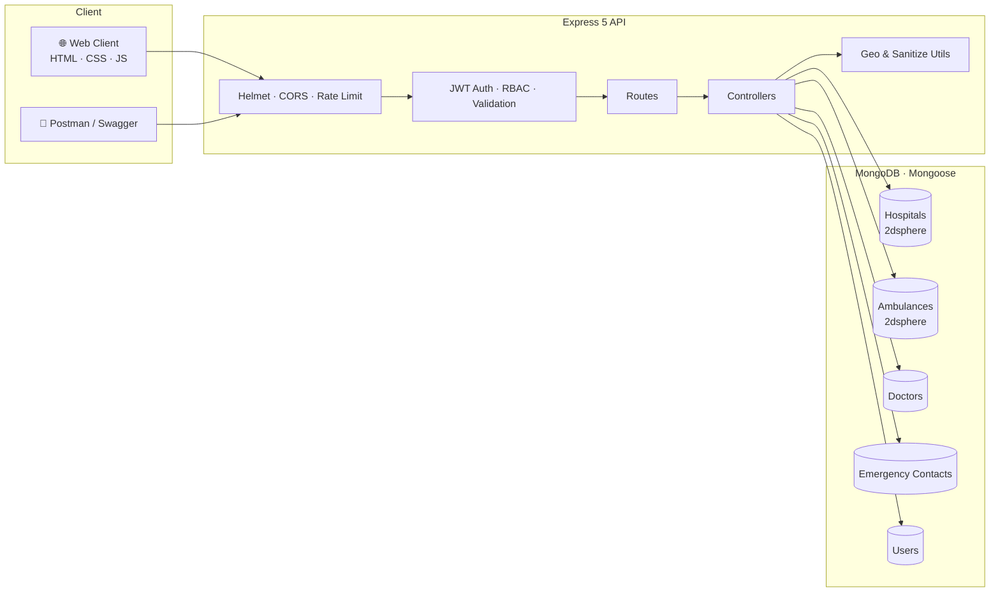
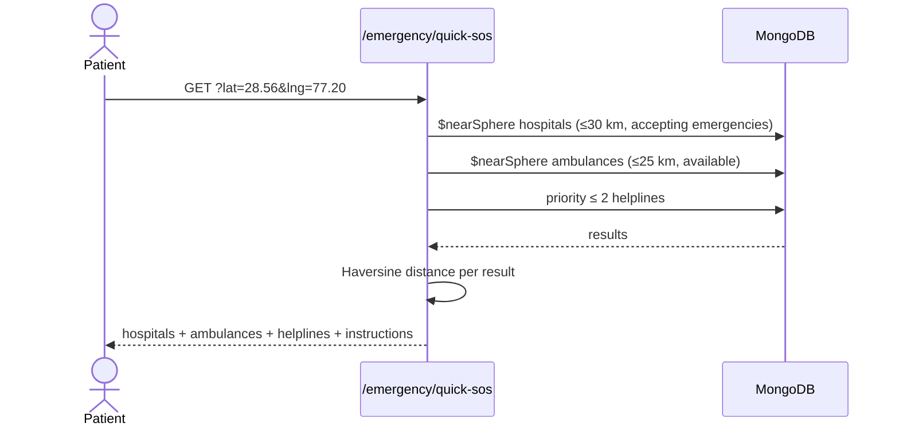

<div align="center">

# 🏥 NEERAJ PHARMA

### Healthcare & Emergency Hospital Locator — Backend Platform

**Find the nearest hospital, check live ICU / oxygen bed availability, dispatch an ambulance, and trigger a 1‑Tap SOS — all from one API.**

<br/>


[Features](#-features) · [Architecture](#-architecture) · [Quick Start](#-quick-start) · [API Reference](#-api-reference) · [Security](#-security-hardening) · [Testing](#-testing) · [Roadmap](#-roadmap)

</div>

---

## 📖 Overview

In a medical emergency, minutes matter — and so does knowing *which* hospital actually has a free ICU bed. **Neeraj Pharma** is a production‑style REST backend, with a bundled responsive web client, that answers three questions in seconds:

1. **Where is the nearest hospital** that is accepting emergencies right now?
2. **Does it have ICU / oxygen / general beds available?**
3. **Which ambulance can reach me, and who do I call?**

It combines MongoDB geospatial indexing, Haversine distance computation, role‑based access control, and live bed‑availability updates by hospital staff into a single deployable service with interactive Swagger documentation.

---

## ✨ Features

| | Capability | Details |
| :-: | :-- | :-- |
| 📍 | **Geolocation search** | Find hospitals by `lat` / `lng` / `radius` using a MongoDB `2dsphere` index, sorted by distance, with Haversine km results |
| 🚨 | **1‑Tap Quick SOS** | One call returns the 3 nearest emergency‑accepting hospitals (≤ 30 km), 3 nearest available ambulances (≤ 25 km) and priority national helplines (112 / 108). Falls back to city matching when GPS is unavailable |
| 🛏️ | **Live bed tracking** | General, ICU and oxygen bed counts plus an "accepting emergencies" flag, updated via a dedicated fast `PATCH` endpoint |
| 🚑 | **Ambulance dispatch** | Fleet registry with type (ALS, BLS, Neonatal, Mobile ICU, PTV), live location and status (`available`, `on_call`, `dispatched`, `maintenance`) |
| 🔎 | **Multi‑filter search** | Keyword, city, specialty, facilities, 24×7 and ICU / oxygen availability, with pagination |
| 👨‍⚕️ | **Doctor directory** | Filter by hospital, specialty and emergency duty |
| 🔐 | **Auth & RBAC** | JWT login, bcrypt hashing, three roles: `user`, `hospital_admin`, `super_admin` |
| ⭐ | **Saved hospitals** | Patients can bookmark hospitals and store personal emergency contacts |
| 🛡️ | **Admin console** | Platform metrics, hospital verification, user role and status management |
| 📘 | **Docs & tooling** | Swagger UI at `/api-docs`, Postman collection, markdown API guide |
| 🖥️ | **Demo web app** | Accessible (ARIA) single‑page client served from the same server |

---

## 🧱 Architecture



### Quick SOS flow



### Role permissions

| Action | Public | User | Hospital Admin | Super Admin |
| :-- | :-: | :-: | :-: | :-: |
| Search hospitals, doctors, ambulances, helplines, Quick SOS | ✅ | ✅ | ✅ | ✅ |
| Save hospitals, edit own profile | – | ✅ | ✅ | ✅ |
| Create / edit hospitals, doctors, ambulances | – | – | ✅ *(own hospital)* | ✅ |
| Update live bed availability | – | – | ✅ *(own hospital)* | ✅ |
| Verify or delete hospitals, manage helplines | – | – | – | ✅ |
| Dashboard stats, manage users and roles | – | – | – | ✅ |

---

## 🗂️ Project Structure

```text
NEERAJ_PHARMA/
├── src/
│   ├── server.js              # Entry point: DB connect, auto-seed, graceful shutdown
│   ├── app.js                 # Express app: security middleware, routes, error handling
│   ├── config/
│   │   ├── db.js              # MongoDB connection with in-memory fallback
│   │   └── swagger.js         # OpenAPI / Swagger UI setup
│   ├── models/                # Hospital · Doctor · Ambulance · EmergencyContact · User
│   ├── controllers/           # auth · hospital · emergency · doctor · admin
│   ├── routes/                # Versioned route definitions with validators
│   ├── middleware/            # auth (protect/authorize) · validate · errorHandler
│   ├── utils/                 # geoUtils (Haversine) · sanitize (regex, pagination, secrets, CORS)
│   ├── seed/seeder.js         # Demo hospitals, doctors, ambulances, helplines, users
│   └── public/                # Responsive demo front-end (index.html, app.js, style.css)
├── test/
│   ├── neerajpharma.test.js   # Jest + Supertest suite (10 feature groups)
│   └── api.integration.js     # Standalone end-to-end integration checks
├── API_DOCUMENTATION.md
├── Neerajpharma_HospitalLocator.postman_collection.json
├── .env.example
└── package.json
```

---

## 🚀 Quick Start

### Prerequisites
- **Node.js 18+** and **npm 9+**
- *(Optional)* A MongoDB instance or Atlas URI — **not required**, see below

### 1. Install

```bash
git clone <YOUR_REPO_URL>
cd NEERAJ_PHARMA
npm install
```

### 2. Configure

```bash
cp .env.example .env
```

Then edit `.env` and replace the placeholder secrets (the server refuses to start with weak ones):

| Variable | Purpose | Default / Rule |
| :-- | :-- | :-- |
| `PORT` | HTTP port | `5000` |
| `NODE_ENV` | `development`, `test` or `production` | `development` |
| `MONGO_URI` | MongoDB connection string | `inmemory` → embedded MongoDB, zero setup |
| `JWT_SECRET` | Token signing key | **≥ 32 characters**, no placeholders |
| `JWT_EXPIRE` | Token lifetime | `30d` |
| `ADMIN_SECRET` | Required to register a `super_admin` | **≥ 16 characters**, no placeholders |
| `CLIENT_URL` | Allowed CORS origin | **Required in production**; `*` is rejected |
| `RATE_LIMIT_WINDOW_MS` / `RATE_LIMIT_MAX` | General API limiter | `900000` ms / `100` requests |
| `AUTH_RATE_LIMIT_MAX` | Login / register limiter | `20` requests per window |

> 💡 **Zero‑config mode:** leave `MONGO_URI=inmemory` (or point it at an unreachable server) and the app launches an embedded MongoDB, then auto‑seeds demo data when the database is empty.

### 3. Run

```bash
npm run dev      # development with hot reload (nodemon)
npm start        # production
```

| Service | URL |
| :-- | :-- |
| 🏥 Web client | http://localhost:5000 |
| 📖 Swagger UI | http://localhost:5000/api-docs |
| 🩺 Health check | http://localhost:5000/health |
| 🔌 API root | http://localhost:5000/api/v1 |

### 4. Seed data

```bash
npm run seed            # load demo data
npm run seed:destroy    # wipe seeded data
```

The seed includes **5 major Delhi‑NCR hospitals** (AIIMS, Safdarjung, Max Saket, Fortis Escorts, Medanta), specialist doctors, ambulances across ALS / BLS / ICU types, national helplines, and three demo accounts:

| Role | Email | Password |
| :-- | :-- | :-- |
| Super Admin | `admin@neerajpharma.com` | `AdminPassword123!` |
| Hospital Admin | `rajesh.verma@aiims.edu` | `HospitalAdmin123!` |
| Patient | `priya.patel@gmail.com` | `UserPassword123!` |

> ⚠️ These are **demo credentials only**. Never seed them into a real deployment.

---

## 🔌 API Reference

**Base URL:** `http://localhost:5000/api/v1` · **Auth header:** `Authorization: Bearer <token>`

Full request/response details are in [`API_DOCUMENTATION.md`](./API_DOCUMENTATION.md), the Swagger UI, and the Postman collection.

<details>
<summary><b>🔐 Auth — <code>/auth</code></b></summary>

| Method | Endpoint | Access | Description |
| :-- | :-- | :-- | :-- |
| `POST` | `/auth/register` | Public | Create an account (`hospital_admin` self‑registration is blocked; `super_admin` needs `adminSecret`) |
| `POST` | `/auth/login` | Public | Receive a JWT |
| `GET` | `/auth/me` | Private | Current profile |
| `PUT` | `/auth/updatedetails` | Private | Update name, phone, emergency contacts |
| `PUT` | `/auth/updatepassword` | Private | Change password (verifies old one) |
| `POST` / `DELETE` | `/auth/saved-hospitals/:hospitalId` | Private | Bookmark / remove a hospital |

</details>

<details>
<summary><b>🏥 Hospitals — <code>/hospitals</code></b></summary>

| Method | Endpoint | Access | Description |
| :-- | :-- | :-- | :-- |
| `GET` | `/hospitals/nearby` | Public | `lat`, `lng`, `radius` (km, default 15), `hasIcu`, `hasOxygen`, `is24x7` |
| `GET` | `/hospitals/search` | Public | Keyword, city, specialty, facilities, 24×7 |
| `GET` | `/hospitals` | Public | Paginated list |
| `GET` | `/hospitals/:id` | Public | Profile with doctors and ambulances |
| `POST` | `/hospitals` | Hospital Admin / Super Admin | Register a hospital |
| `PUT` | `/hospitals/:id` | Hospital Admin / Super Admin | Update profile |
| `PATCH` | `/hospitals/:id/availability` | Hospital Admin / Super Admin | Update live bed counts |
| `PATCH` | `/hospitals/:id/verify` | Super Admin | Verify credentials |
| `DELETE` | `/hospitals/:id` | Super Admin | Soft delete |

</details>

<details>
<summary><b>🚨 Emergency — <code>/emergency</code></b></summary>

| Method | Endpoint | Access | Description |
| :-- | :-- | :-- | :-- |
| `GET` | `/emergency/quick-sos` | Public | Hospitals + ambulances + helplines in one response |
| `GET` | `/emergency/contacts` | Public | National and city helplines |
| `POST` / `PUT` / `DELETE` | `/emergency/contacts[/:id]` | Super Admin | Manage helplines |
| `GET` | `/emergency/ambulances` | Public | Nearby (GPS) or by city |
| `POST` | `/emergency/ambulances` | Hospital Admin / Super Admin | Register an ambulance |
| `PATCH` | `/emergency/ambulances/:id/status` | Hospital Admin / Super Admin | Update dispatch status |

</details>

<details>
<summary><b>👨‍⚕️ Doctors — <code>/doctors</code></b></summary>

| Method | Endpoint | Access | Description |
| :-- | :-- | :-- | :-- |
| `GET` | `/doctors` | Public | Filter by hospital, specialty, emergency duty |
| `GET` | `/doctors/:id` | Public | Doctor profile |
| `POST` / `PUT` / `DELETE` | `/doctors[/:id]` | Hospital Admin / Super Admin | Manage roster |

</details>

<details>
<summary><b>🛡️ Admin — <code>/admin</code></b> (Super Admin only)</summary>

| Method | Endpoint | Description |
| :-- | :-- | :-- |
| `GET` | `/admin/dashboard-stats` | System‑wide metrics and bed totals |
| `GET` | `/admin/users` | Paginated users |
| `PATCH` | `/admin/users/:id/role` | Change role |
| `PATCH` | `/admin/users/:id/status` | Activate / deactivate |

</details>

### Try it

```bash
# 1. Nearest hospitals with an available ICU bed within 10 km of Delhi
curl "http://localhost:5000/api/v1/hospitals/nearby?lat=28.5672&lng=77.2090&radius=10&hasIcu=true"

# 2. One-tap SOS
curl "http://localhost:5000/api/v1/emergency/quick-sos?lat=28.5672&lng=77.2090"

# 3. Log in and update live bed availability
TOKEN=$(curl -s -X POST http://localhost:5000/api/v1/auth/login \
  -H "Content-Type: application/json" \
  -d '{"email":"rajesh.verma@aiims.edu","password":"HospitalAdmin123!"}' | jq -r .token)

curl -X PATCH "http://localhost:5000/api/v1/hospitals/<HOSPITAL_ID>/availability" \
  -H "Authorization: Bearer $TOKEN" -H "Content-Type: application/json" \
  -d '{"availableIcuBeds": 4, "availableBeds": 35}'
```

---

## 🛡️ Security Hardening

| Layer | Implementation |
| :-- | :-- |
| **HTTP headers** | `helmet` with an explicit Content Security Policy |
| **Rate limiting** | 100 req / 15 min on the API, 20 req / 15 min on auth routes |
| **CORS** | Explicit `CLIENT_URL` mandatory in production; wildcard rejected |
| **Secrets** | Fail‑fast startup check rejects short or placeholder `JWT_SECRET` / `ADMIN_SECRET` |
| **Passwords** | `bcryptjs` hashing; password field excluded from queries (`select: false`) |
| **Auth errors** | Uniform `401 Invalid credentials`, so no user enumeration and no internal message leakage |
| **Privilege escalation** | `hospital_admin` self‑registration blocked; `super_admin` requires `ADMIN_SECRET` |
| **Ownership** | Hospital admins can only modify their assigned hospital |
| **Mass assignment** | Strict field whitelisting on hospital and doctor updates |
| **Injection** | `express-validator` on mutating routes; regex‑escaped search input |
| **Abuse control** | Pagination capped at 100 items per page; deactivated accounts rejected on every request |
| **Error handling** | Centralized handler; graceful shutdown on `SIGINT` / `SIGTERM` |

---

## 🧪 Testing

```bash
npm test                  # Jest + Supertest (runs against in-memory MongoDB)
npm run test:integration  # Standalone integration suite
npm run test:all          # Both
```

The Jest suite is organised into ten groups: **schemas and geospatial indexes**, **hospital CRUD and availability**, **Haversine search**, **Quick SOS and dispatch**, **multi‑filter search and pagination**, **JWT / bcrypt / RBAC**, **admin metrics**, **input validation**, **security hardening**, and **docs / health checks**.

---

## 🧰 Tech Stack

| Area | Technology |
| :-- | :-- |
| Runtime & framework | Node.js, Express 5 |
| Database | MongoDB, Mongoose 9 (`2dsphere` + text indexes), `mongodb-memory-server` |
| Auth & security | `jsonwebtoken`, `bcryptjs`, `helmet`, `cors`, `express-rate-limit`, `express-validator` |
| Docs & logging | `swagger-ui-express`, `morgan` |
| Testing | Jest, Supertest |
| Front‑end | Vanilla HTML / CSS / JS, ARIA‑accessible |

---

## 🗺️ Roadmap

- [ ] Real‑time bed updates over WebSockets / Server‑Sent Events
- [ ] Ambulance live tracking and ETA via a routing API
- [ ] SMS / WhatsApp SOS alerts to saved emergency contacts
- [ ] Appointment booking and teleconsultation
- [ ] Multi‑language UI (Hindi and regional languages)
- [ ] Docker image and CI pipeline

---

## 🤝 Contributing

1. Fork the repository and create a branch: `git checkout -b feature/your-feature`
2. Make your changes and add tests
3. Run `npm run test:all`
4. Open a pull request describing the change

---

## 📄 License

Released under the **ISC License**.

<div align="center">

**Built with care for faster, smarter emergency healthcare access in India. 🇮🇳**

</div>
