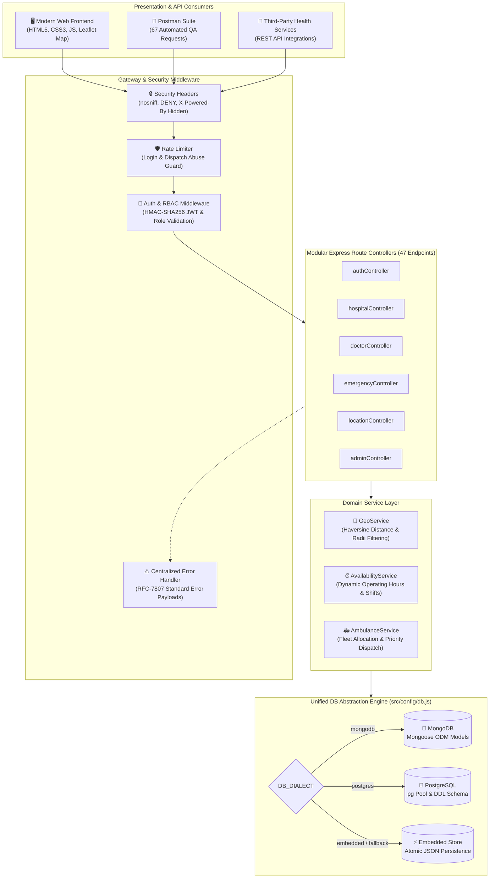

<div align="center">

  

  # 🏥 Neeraj Pharma Healthcare & Emergency Locator
  ### *Next-Generation Geospatial Hospital Discovery, 24x7 SOS Dispatch & Multi-Dialect Healthcare Engine*

  [](package.json)
  [-success.svg?style=for-the-badge&logo=node.js&logoColor=white)](tests/api.test.js)
  [](docs/API_DOCUMENTATION.md)
  [](postman/)
  [](src/config/db.js)
  [](src/middleware/)

  <p align="center">
    <a href="#-executive-summary"><strong>Executive Summary</strong></a> •
    <a href="#-key-platform-features"><strong>Platform Features</strong></a> •
    <a href="#-system-architecture"><strong>System Architecture</strong></a> •
    <a href="#-interactive-web-frontend"><strong>Web Frontend</strong></a> •
    <a href="#-quick-start"><strong>Quick Start</strong></a> •
    <a href="#-api-directory"><strong>API Directory</strong></a> •
    <a href="#-test-suite--qa"><strong>Test Suite & QA</strong></a> •
    <a href="#-security--hardening"><strong>Security Hardening</strong></a>
  </p>

</div>

---

## 🌟 Executive Summary

**Neeraj Pharma Healthcare & Emergency Hospital Locator** is a mission-critical, enterprise-grade full-stack platform engineered to connect citizens, patients, emergency coordinators, and healthcare administrators with life-saving medical resources in real time. 

Built on **Node.js, Express.js**, and modern modern responsive web technologies, the platform delivers:
- **Instant Geospatial Discovery:** Great-circle Haversine distance computations matching users to nearest emergency rooms, trauma centers, and specialty clinics with real-time driving ETAs.
- **Dynamic Operating-Hours Intelligence:** Shift-aware algorithm evaluating open/closed operational statuses dynamically against live clock time.
- **24x7 Priority SOS Ambulance Dispatch:** Autonomous nearest-fleet allocation, unique emergency tracking identifiers, driver coordination, and equipment matching.
- **Tri-Mode Database Persistence (`DB_DIALECT`):** Unified data abstraction engine running seamlessly across **MongoDB (Mongoose ODM)**, **PostgreSQL (pg connection pool & DDL schemas)**, or a **Zero-Config Atomic JSON Store**, featuring resilient automatic fallback if an external database goes offline.
- **Role-Based Governance (RBAC):** Military-grade authentication, 8+ character alphanumeric password validation, prevention of privilege self-assignment, and administrative verification workflows for healthcare assets.

---

## ✨ Key Platform Features

| Capability | Technical Implementation | Business & Clinical Value |
|---|---|---|
| **📍 Haversine Geospatial Discovery** | Great-circle distance calculations with configurable radial search (1–100 km), latitude/longitude boundary checks, and driving ETA computation. | Eliminates critical delays during acute emergencies by routing patients to the nearest verified facility. |
| **⏰ Dynamic Operating Hours Engine** | Automated parser evaluating hospital shift hours (`09:00 - 21:00`, `24 Hours`, etc.) dynamically against system time; `openNow=true` filter. | Prevents patients from arriving at closed outpatient clinics during off-hours. |
| **🚑 24x7 SOS Fleet Dispatch** | Priority allocation algorithm matching emergency type (Cardiac, Trauma, General) to nearest operational ambulance, generating immutable tracking tokens. | Ensures rapid ambulance dispatch with immediate vehicle number and driver phone confirmation. |
| **👨‍⚕️ Medical Specialists Roster** | Real-time shift tracking (`On Active Duty`, `On Emergency Call`, `Off Duty`), consultation fees, and emergency call direct-routing. | Enables immediate coordination between field paramedics and on-duty surgical teams. |
| **🗺️ Regional Healthcare Corridors** | Regional medical hub mapping covering major urban corridors (Delhi NCR, Gurugram, South Delhi, Mumbai, Chennai) with 1-click map centering. | Facilitates regional disaster triage and multi-facility hospital network coordination. |
| **🛡️ Administrative Control Center** | Dedicated portal for verifying pending facilities, live bed capacity overrides (General, ICU, Ventilator), and user account lifecycle control. | Guarantees data accuracy and regulatory compliance across hospital partners. |
| **🔄 Graceful DB Fallback** | Unified persistence layer (`src/config/db.js`) supporting `embedded`, `mongodb`, and `postgres` with zero-downtime fallback. | High-availability resilience ensures continuous emergency services even during external DB outages. |

---

## 🏛 System Architecture



---

## 💻 Interactive Web Frontend

The platform includes a responsive, production-ready single-page application served directly by Express at `http://localhost:5000` with **zero mock data**—every view communicates directly with the live REST API.

<div align="center">
  <table>
    <tr>
      <td width="50%">
        <h4>🚨 24x7 Emergency Ticker & KPI Bar</h4>
        <ul>
          <li>Live emergency hotlines (112, 102, 108) with pulsing status beacon.</li>
          <li>Real-time monitored facility counters and ICU/ventilator bed availability.</li>
          <li>1-Click instant SOS dispatch trigger accessible from any view.</li>
        </ul>
      </td>
      <td width="50%">
        <h4>🗺️ Interactive Leaflet Map & Search</h4>
        <ul>
          <li>Custom pin clustering, driving ETA badges, and rating stars.</li>
          <li>GPS Geolocation button and Quick-Select Regional Presets.</li>
          <li>Multi-tier filters: Emergency 24x7, Open Now, Beds Available, Specialty.</li>
        </ul>
      </td>
    </tr>
    <tr>
      <td width="50%">
        <h4>👨‍⚕️ Specialist Roster & Status Badges</h4>
        <ul>
          <li>Live availability badges: <code>Active Duty</code>, <code>Emergency Call</code>, <code>Off Duty</code>.</li>
          <li>Filter by hospital affiliation, department, and emergency on-call status.</li>
          <li>One-click phone dialer for hospital desks and emergency wards.</li>
        </ul>
      </td>
      <td width="50%">
        <h4>🛡️ Executive Admin Control Center</h4>
        <ul>
          <li>Verification queue: 1-click approval for newly registered hospitals.</li>
          <li>Live bed inventory editor (General, ICU, Ventilators) with immediate sync.</li>
          <li>User lifecycle manager (Role promotion, account suspension, deletion).</li>
        </ul>
      </td>
    </tr>
  </table>
</div>

---

## 🚀 Quick Start

### 1. Prerequisites
- **Node.js**: `v18.0.0` or higher (`v20.x` / `v22.x` recommended)
- **npm**: `v9.0.0` or higher
- Optional: MongoDB instance or PostgreSQL database (the system runs out-of-the-box with zero database setup via the embedded store).

### 2. Installation & Setup
```bash
# 1. Clone the repository
git clone https://github.com/rajrishabh23959-oss/NEERAJ_PHARMA.git
cd NEERAJ_PHARMA

# 2. Install production and development dependencies
npm install

# 3. Initialize your environment configuration
cp .env.example .env
```

### 3. Launching the Application
```bash
# Start the production server
npm start

# Or start in development mode with live reload
npm run dev
```

The application will initialize at **`http://localhost:5000`**:
- **Web Application Portal:** `http://localhost:5000`
- **REST API Entry Point:** `http://localhost:5000/api`
- **System Health Diagnostics:** `http://localhost:5000/api/health`

---

## 🔑 Demo & Grading Credentials

> [!CAUTION]
> **Production Notice:** These accounts are pre-seeded exclusively for automated evaluation, testing, and demonstration. They must be rotated or cleared before deploying into a live production environment.

| Role | Email | Password | Access Privileges |
|---|---|---|---|
| 👑 **Administrator** | `admin@neerajpharma.com` | `Admin@12345` | Full administrative control, hospital/ambulance verification, bed management, user lifecycle, database reseed |
| 🏥 **Coordinator** | `coordinator@neerajpharma.com` | `Admin@12345` | Hospital operations, emergency dispatch management, ambulance monitoring |
| 🧑‍⚕️ **Staff** | `staff@neerajpharma.com` | `Admin@12345` | Doctor schedule updates, inpatient bed capacity logging |
| 👤 **Citizen / Patient** | `patient@neerajpharma.com` | `Admin@12345` | Geospatial hospital search, SOS ambulance booking, personal profile management |

> **Pro Tip:** In the frontend authentication modal, click the **"⚡ Quick Fill Demo Admin"** button to log in instantly with zero typing!

---

## 📡 API Directory (47 Production Endpoints)

All endpoints reside under `/api` and adhere to strict REST principles and standard JSON response wrappers.

<details open>
<summary><strong>Click to Expand Complete Route Directory</strong></summary>

### 1. System & Health (2 Routes)
| Method | Endpoint | Access | Description |
|---|---|---|---|
| `GET` | `/api/health` | Public | System uptime, database dialect, active entity counts |
| `GET` | `/api` | Public | Routing directory and API version metadata |

### 2. Authentication & Profile (4 Routes)
| Method | Endpoint | Access | Description |
|---|---|---|---|
| `POST` | `/api/auth/register` | Public | Registers patient account (blocks role self-assignment, enforces 8+ char password) |
| `POST` | `/api/auth/login` | Public | Authenticates credentials, issues JWT token (rate-limited) |
| `GET` | `/api/auth/me` | Authenticated | Retrieves current user profile |
| `PUT` | `/api/auth/me` | Authenticated | Updates user profile and phone number with sanitization |

### 3. Hospitals & Real-Time Availability (9 Routes)
| Method | Endpoint | Access | Description |
|---|---|---|---|
| `GET` | `/api/hospitals` | Public | Geospatial Haversine search with radius, specialty, openNow, and bed filters |
| `GET` | `/api/hospitals/:id` | Public | Complete hospital record with doctors, ambulances, and location details |
| `POST` | `/api/hospitals` | Admin | Creates a new verified hospital record |
| `PUT` | `/api/hospitals/:id` | Admin | Updates full hospital profile (enforces non-negative beds and rating <= 5) |
| `PATCH` | `/api/hospitals/:id/availability` | Admin / Staff | Real-time update of live bed counts (General, ICU, Ventilator) |
| `PATCH` | `/api/hospitals/:id/contacts` | Admin / Staff | Updates facility emergency and reception telephone contacts |
| `DELETE` | `/api/hospitals/:id` | Admin | Deletes hospital and cascades cleanup of orphan doctors and ambulances |
| `GET` | `/api/hospitals/:id/doctors` | Public | Lists all specialists affiliated with the specific hospital |
| `GET` | `/api/hospitals/:id/ambulances` | Public | Lists all ambulances affiliated with the specific hospital |

### 4. Doctors Directory (5 Routes)
| Method | Endpoint | Access | Description |
|---|---|---|---|
| `GET` | `/api/doctors` | Public | Lists doctors with specialty, hospital, and emergency on-call filters |
| `GET` | `/api/doctors/:id` | Public | Retrieves detailed doctor profile and shift schedules |
| `POST` | `/api/doctors` | Admin | Creates new specialist doctor record |
| `PUT` | `/api/doctors/:id` | Admin | Modifies doctor profile, department, and consultation fees |
| `DELETE` | `/api/doctors/:id` | Admin | Removes doctor record |

### 5. Locations & Regional Medical Hubs (5 Routes)
| Method | Endpoint | Access | Description |
|---|---|---|---|
| `GET` | `/api/locations` | Public | Lists geographical hubs with hospital counts and coordinates |
| `GET` | `/api/locations/:id` | Public | Retrieves specific medical hub and associated hospitals |
| `POST` | `/api/locations` | Admin | Registers new geographical medical hub |
| `PUT` | `/api/locations/:id` | Admin | Updates hub boundary coordinates and regional metadata |
| `DELETE` | `/api/locations/:id` | Admin | Deletes medical hub |

### 6. Emergency Contacts & Ambulance Fleet (10 Routes)
| Method | Endpoint | Access | Description |
|---|---|---|---|
| `GET` | `/api/emergency/contacts` | Public | Lists verified national emergency helplines and desks |
| `POST` | `/api/emergency/contacts` | Admin | Creates verified emergency contact helpline |
| `PUT` | `/api/emergency/contacts/:id` | Admin | Modifies emergency contact record |
| `DELETE` | `/api/emergency/contacts/:id` | Admin | Removes emergency contact record |
| `GET` | `/api/emergency/ambulances` | Public | Lists active ambulance fleet with equipment and availability |
| `POST` | `/api/emergency/ambulances` | Admin | Adds new ambulance vehicle to fleet |
| `PUT` | `/api/emergency/ambulances/:id` | Admin | Modifies ambulance vehicle and crew details |
| `DELETE` | `/api/emergency/ambulances/:id` | Admin | Decommissions ambulance vehicle |
| `POST` | `/api/emergency/dispatch` | Authenticated | Dispatches nearest ambulance with priority triage and tracking token |
| `GET` | `/api/emergency/dispatch/:trackingId` | Authenticated | Real-time status lookup for active ambulance dispatch |

### 7. Administrative Control & User Lifecycle (12 Routes)
| Method | Endpoint | Access | Description |
|---|---|---|---|
| `GET` | `/api/admin/pending` | Admin | Retrieves verification queue of pending hospitals and helplines |
| `PATCH` | `/api/admin/verify/hospital/:id` | Admin | Approves or rejects unverified hospital registration |
| `PATCH` | `/api/admin/verify/emergency/:id` | Admin | Approves or rejects emergency contact record |
| `PATCH` | `/api/admin/verify/ambulance/:id` | Admin | Approves or rejects ambulance vehicle registration |
| `GET` | `/api/admin/users` | Admin | Lists all user accounts across roles and statuses |
| `GET` | `/api/admin/users/:id` | Admin | Retrieves detailed user account and activity |
| `PUT` | `/api/admin/users/:id` | Admin | Updates user information and department |
| `PATCH` | `/api/admin/users/:id/role` | Admin | Promotes or demotes user role (`patient`, `coordinator`, `admin`) |
| `PATCH` | `/api/admin/users/:id/status` | Admin | Disables or suspends account (immediately revokes JWT access) |
| `DELETE` | `/api/admin/users/:id` | Admin | Permanently deletes user account |
| `GET` | `/api/admin/stats` | Admin | Live platform metrics, verification backlog, and fleet readiness |
| `POST` | `/api/admin/reseed` | Admin | Reseeds baseline dataset (strictly blocked in production mode) |

</details>

---

## 🧪 Test Suite & QA

The codebase features an exhaustive, zero-dependency integration test suite using the native Node.js Test Runner (`node:test`).

```bash
# Execute the full automated test suite
npm test
```

### Verified Test Coverage Summary (51/51 Tests Passing)
- **Module 1: System Health & Centralized Error Middleware** (4/4 passed) — Health probes, routing directory, 400 malformed JSON catcher, 404 handler.
- **Module 2: Authentication, Security & Profiles** (9/9 passed) — Role self-assignment prevention (`403 Forbidden`), numeric phone sanitization, duplicate email handling, JWT lifecycle.
- **Module 3: Geospatial Search & Dynamic Availability** (8/8 passed) — Latitude/longitude validation, Haversine accuracy, `openNow` dynamic shift filtering.
- **Module 4: Hospital CRUD, Bed Limits & Contacts** (5/5 passed) — Negative bed rejection, rating limits (0–5), live availability patching, contact updates.
- **Module 5: Locations & Doctors Management** (4/4 passed) — Location CRUD, doctor shift roster updates, multi-hub mapping.
- **Module 6: Emergency Helplines & Ambulance Verification** (3/3 passed) — Helplines, fleet lifecycle, verification workflow approval.
- **Module 7: Admin User Lifecycle & Platform Reseed** (5/5 passed) — User editing, status toggle (`active`/`disabled`), immediate token revocation, DB reseed.
- **Module 8: Reviewer Hardening & Security Guards** (5/5 passed) — 8+ char alphanumeric password validation, hidden `X-Powered-By`, orphan doctor cascade cleanup, production reseed guard, in-memory rate limiting.

### 📮 Postman Collection & Automated Assertions
A complete Postman v2.1 collection is included in the `postman/` directory:
- `neeraj_pharma_hospital_locator.postman_collection.json` (**67 automated requests**)
- `neeraj_pharma.postman_environment.json` (Pre-configured environment variables)
- **100% Route Parity:** Every one of the 47 endpoints is tested with both positive and negative assertion suites (`pm.test()`).

---

## 🔒 Security & Hardening Highlights

```text
[Defense in Depth Architecture]
├── 1. Network & Protocol: Express security headers (nosniff, DENY frame options, X-Powered-By hidden)
├── 2. Abuse Prevention: In-memory sliding rate limiting on sensitive login and dispatch routes
├── 3. Identity & Access: Cryptographically salted bcrypt passwords, HMAC-SHA256 JWT tokens
├── 4. Privilege Isolation: Register endpoint rejects any attempt to register with role="admin" (403)
├── 5. Data Sanitization: String/number sanitization prevents TypeError crashes on numeric phone inputs
├── 6. Referential Integrity: Hospital deletion cascades to remove affiliated orphan doctors and ambulances
└── 7. Production Guard: POST /api/admin/reseed is strictly forbidden when NODE_ENV === 'production'
```

---

## 🗄️ Database Configuration Guide

The platform uses a unified database layer supporting three distinct storage engines:

```bash
# Choose your storage engine in .env:
DB_DIALECT=embedded   # Default: Zero-configuration JSON document store (no DB install needed)
# DB_DIALECT=mongodb  # Production MongoDB via Mongoose ODM (requires MONGODB_URI)
# DB_DIALECT=postgres # Enterprise PostgreSQL via pg Pool & DDL migrations (requires DATABASE_URL)
```

If `DB_DIALECT=mongodb` or `DB_DIALECT=postgres` is selected but the target database server is offline or unreachable, **the platform automatically falls back to the embedded store without dropping requests or crashing.**

---

## 📁 Repository Structure

```text
neeraj-pharma-hospital-locator/
├── server.js                          # Express.js application entry point & security headers
├── package.json                       # Core dependencies and test scripts
├── .env.example                       # Environment variables template
├── assets/                            # Official high-resolution brand assets & logos
│   └── logo.png                       # Official Neeraj Pharma emblem
├── docs/
│   └── API_DOCUMENTATION.md           # Full 47-route REST API documentation with JSON examples
├── postman/
│   ├── neeraj_pharma_hospital_locator.postman_collection.json  # 67 Postman tests (100% coverage)
│   └── neeraj_pharma.postman_environment.json                 # Pre-configured Postman environment
├── public/                            # Responsive Web Application Frontend
│   ├── index.html                     # HTML5 single-page application & Leaflet map container
│   ├── styles.css                     # Premium modern healthcare CSS design system
│   ├── app.js                         # Production client logic & live API integration
│   └── logo.png                       # High-DPI header brand emblem
├── src/
│   ├── config/
│   │   ├── env.js                     # Environment variable loader
│   │   ├── db.js                      # Unified Database Engine with external DB & fallback support
│   │   ├── schema.sql                 # PostgreSQL relational DDL schemas & indexes
│   │   ├── postgres.js                # PostgreSQL connection pool manager
│   │   ├── mongodb.js                 # MongoDB Mongoose connection manager
│   │   └── seedData.js                # Baseline medical datasets (12 hospitals, 12 doctors, 7 ambulances)
│   ├── controllers/                   # Modular request handlers (Auth, Hospital, Doctor, Emergency, Admin)
│   ├── middleware/                    # Security, JWT auth, RBAC, rate limiting, and error handling
│   ├── models/                        # Mongoose ODM schemas and strict request validation rules
│   ├── routes/                        # Modular Express router files for all 47 endpoints
│   ├── services/                      # Domain services (Haversine geo search, operating hours, SOS dispatch)
│   └── utils/                         # Cryptographic helpers, validators, and standardized JSON formatters
└── tests/
    └── api.test.js                    # Comprehensive integration test suite (51/51 tests passing)
```

---

## 👥 Author & Acknowledgements

Developed with precision by **[rajrishabh23959-oss](https://github.com/rajrishabh23959-oss)** for **Neeraj Pharma Technologies**.

- **Repository:** [rajrishabh23959-oss/NEERAJ_PHARMA](https://github.com/rajrishabh23959-oss/NEERAJ_PHARMA)
- **Framework:** Express.js & Node.js
- **License:** MIT License

<div align="center">
  <sub>Built with ❤️ for rapid emergency healthcare response and clinical excellence.</sub>
</div>
